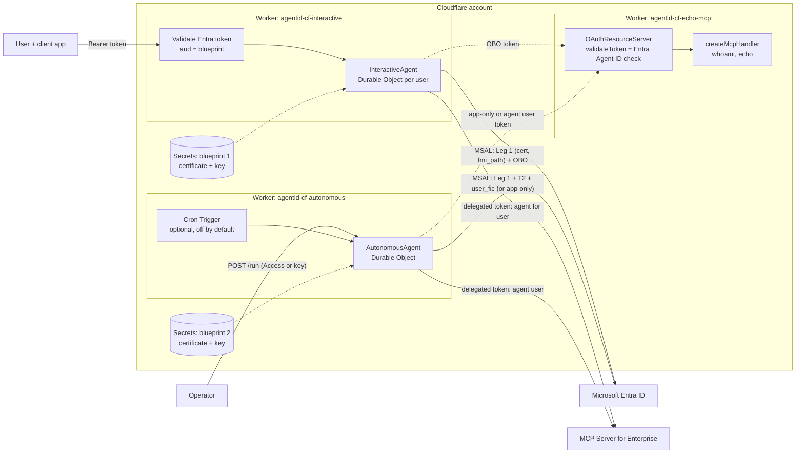

# Microsoft Entra Agent ID on Cloudflare Workers

A sample that gives agents running on **Cloudflare's Agents runtime** (Workers + the Agents SDK
on Durable Objects) a **Microsoft Entra Agent ID**, using **MSAL Node** in-process (no sidecar
container) and a **certificate** on the agent identity blueprint.

It is the Cloudflare counterpart of
[astaykov/agentid-agentcore](https://github.com/astaykov/agentid-agentcore) (AWS Bedrock
AgentCore), with two scenarios and an MCP server of its own:

| Scenario | Inbound | Outbound | Target |
|---|---|---|---|
| **Interactive agent** | Entra user token, audience = the agent's blueprint, scope `access_agent` | **On-behalf-of** the user, as the agent identity | Microsoft MCP Server for Enterprise |
| **Autonomous agent** | none for the agent; an operator starts each run (`POST /run`, via Cloudflare Access or a key), a schedule is optional | **Its own identity**: its agent user (`user_fic`) or app-only | Microsoft MCP Server for Enterprise (agent user) or any MCP server that accepts app tokens |
| **Echo MCP server** (optional) | Entra tokens from agents only: OBO, app-only or agent user | - | Shows each caller's flow, agent identity, blueprint and user |

The echo MCP server runs on Cloudflare and is guarded by Cloudflare's MCP tooling:
`OAuthResourceServer` (`@cloudflare/workers-oauth-provider`) in front of the Agents SDK's
`createMcpHandler`, with an Entra Agent ID check as its token validator. A dependency-free
edition does the same without packages. See [which Cloudflare built-ins play the role of AWS
authorizers](docs/cloudflare-built-ins.md), and which do not fit Agent ID.

> **Sample code.** Not production-hardened. It depends on two preview features: Microsoft MCP
> Server for Enterprise (preview) and, for the autonomous agent-user mode, agent users
> (Frontier preview program). See [Status and open items](#status-and-open-items).

## How it works



1. **Credential.** Each Worker holds its own blueprint's certificate and private key as Worker
   secrets (or in Secrets Store). The key is imported into WebCrypto as non-extractable.
2. **Leg 1.** MSAL's blueprint client sends a certificate-signed client assertion (PS256,
   `x5t#S256`, `x5c`) and `fmi_path = <agent identity>`; Entra returns T1.
3. **Leg 2.** MSAL's agent identity client uses T1 as its client assertion for:
   OBO with the user's token (interactive), client credentials (app-only), or T2 + `user_fic`
   (agent user).
4. **MCP.** The agent calls the MCP server over Streamable HTTP with the resulting token.
   Tokens never reach the LLM, the logs or the HTTP responses.
5. **Resource side.** The echo MCP server validates the Entra token, works out the flow from the
   agent claims (`azp`, `xms_par_app_azp`, `xms_act_fct`, `xms_sub_fct`), applies a caller policy
   (agents only, allowed blueprints, agent identities, flows) and hands the caller to the tools.

Details, wire requests and claims: [docs/token-flows.md](docs/token-flows.md).

## Compared with the AWS AgentCore sample

| | AWS AgentCore sample | This sample |
|---|---|---|
| Blueprint credential | Federated identity credential trusting AWS STS outbound identity federation (secretless) | **Certificate** (Cloudflare has no platform-issued workload identity token) |
| Agent runtime | AgentCore Runtime (container), Lambda | Workers + Agents SDK (Durable Objects) |
| Inbound authorization | AgentCore JWT authorizer | Validation in the Worker before the Agent is touched (`inbound-auth.ts`); optional edge validation with API Shield (Enterprise) |
| Operator / scheduler access | IAM (SigV4) on `InvokeAgentRuntime` | Cloudflare Access on the Worker (`ctx.access`), or a shared key |
| Protected MCP / tool endpoint | Echo API behind the AgentCore authorizer | Echo **MCP** server: `OAuthResourceServer` + `createMcpHandler` with an Entra Agent ID validator |
| Library | MSAL Python 1.37+ | MSAL Node 7.1+ (`fmiPath` and `acquireTokenByUserFederatedIdentityCredential` since 5.3.0; OBO) |
| Token cache | Per process | Per isolate, MSAL in-memory |
| Scheduling | EventBridge Scheduler + Lambda | Runs when an operator starts it (`npm run autonomous:run`); optional Cron Trigger |
| Downstream | Echo API, MCP Server for Enterprise | MCP Server for Enterprise, echo MCP server (optional; also over a service binding) |
| LLM | Bedrock (Strands) | Workers AI (optional) |
| Agent-to-agent | v3: three agents over A2A | Not in this version |

## Quick start

**Run every command from the project root:** the folder that contains `package.json`, `src/`,
`workers/` and `scripts/`. If Windows "Extract All" added an extra folder level, go one level
down, into the folder that has `package.json`:

```powershell
cd C:\src\agentid-cloudflare      # your copy; "dir package.json" must find the file
```

There is one `package.json` and one `node_modules` for all five Workers. A folder under
`workers/` holds only that Worker's `wrangler.jsonc` (and its local `.dev.vars`); the npm scripts
select the Worker with `-c workers/<name>/wrangler.jsonc`, so you never `cd` into it. See
[Where to run commands and where files go](#where-to-run-commands-and-where-files-go).

1. **Install** (Node 22+): `npm install`, then `npm test`. Behind a package mirror, run
   `npm run check:feed` first: it lists every package the mirror cannot serve in one go
   ([restricted-package-feeds.md](docs/restricted-package-feeds.md)).
2. **Certificates:** `npm run cert:interactive` and `npm run cert:autonomous`
   ([certificate-auth.md](docs/certificate-auth.md)).
3. **Entra:** copy `scripts/entra/entra.config.example.json` to `scripts/entra/entra.config.json`
   (same folder), edit it, run `npm run entra:setup` ([entra-setup-guide.md](docs/entra-setup-guide.md)).
4. **Configure:** put the printed IDs into the `vars` of `workers/interactive/wrangler.jsonc` and
   `workers/autonomous/wrangler.jsonc`.
5. **Deploy:** `npm run deploy:interactive` and `npm run deploy:autonomous`, then store each
   Worker's certificate and key with `npx wrangler secret put ... -c workers/<name>/wrangler.jsonc`
   (bash and PowerShell commands in
   [cloudflare-deploy-guide.md](docs/cloudflare-deploy-guide.md#4-deploy-and-add-the-secrets)).
6. **Check:** `curl https://agentid-cf-interactive.<subdomain>.workers.dev/healthz` (type `curl.exe`
   in Windows PowerShell 5.1, where `curl` is an alias for `Invoke-WebRequest`).
7. **Interactive:** `npm run cli -- login ...`, then `whoami`, `tools`, `chat "How many users are in my tenant?"`
   (`chat --debug "..."` also shows what the model did at each step).
   The agent remembers your last 4 turns for 30 minutes; `chat --new "..."` starts a new conversation.
8. **Autonomous:** it has no schedule by default and runs only when you start it (or put the Worker
   behind Cloudflare Access: `ADMIN_AUTH=access`). `npm run autonomous:status` shows the last runs.
   * bash: `AUTONOMOUS_ADMIN_KEY=... npm run autonomous:run -- --url https://agentid-cf-autonomous.<subdomain>.workers.dev`
   * PowerShell: `$env:AUTONOMOUS_ADMIN_KEY = "..."; npm run autonomous:run -- --url https://agentid-cf-autonomous.<subdomain>.workers.dev`
9. **Echo MCP server (optional):** enable `echo` in the Entra config and run `npm run entra:setup`
   (it also adds the Agent ID optional claims to the echo app's tokens), `npm run deploy:echo`, then
   set `ECHO_MCP_URL` and `ECHO_MCP_SCOPES` on the interactive agent: it keeps MCP Server for
   Enterprise and gets the echo server as a second MCP server
   ([Call the echo MCP server from the interactive agent](#call-the-echo-mcp-server-from-the-interactive-agent)).

## Call the echo MCP server from the interactive agent

The interactive agent can use two MCP servers at the same time. It asks Entra for a separate
on-behalf-of token for each one: both tokens carry the same agent identity (`azp`) and the same
user (`oid`), each with its own audience (`aud`) and scopes (`scp`).

| Server id | Settings in `workers/interactive/wrangler.jsonc` | Token audience |
|---|---|---|
| `enterprise` | `MCP_SERVER_URL`, `MCP_SCOPES` | Microsoft MCP Server for Enterprise |
| `echo` (optional) | `ECHO_MCP_URL`, `ECHO_MCP_SCOPES` (empty = off), optional `ECHO_MCP_SERVICE` binding | The echo app (`api://<echo app id>`) |

1. **Entra:** set `"enabled": true` in the `echo` section of `scripts/entra/entra.config.json` and run
   `npm run entra:setup` again (it is idempotent). It creates the echo app, adds the Agent ID
   optional claims to its access tokens, grants the interactive agent identity `Echo.Read` and
   prints the values for steps 2 and 3. The optional claims matter: `xms_par_app_azp`,
   `xms_act_fct` and `xms_sub_fct` are claims of the **resource**, so Entra puts them into the
   agent's token only because the echo app registration asks for them. Without them the echo
   server cannot tell an agent from any other app and answers `403 access_denied`.
2. **Echo server:** put `TENANT_ID`, `ECHO_APP_ID` and `ALLOWED_BLUEPRINT_IDS` into
   `workers/echo-mcp/wrangler.jsonc`, then `npm run deploy:echo`. No secrets.
3. **Interactive agent:** in `workers/interactive/wrangler.jsonc`, uncomment the service binding and
   add the echo server to `vars`, then `npm run deploy:interactive` (the certificate secrets stay):

   ```jsonc
   "services": [{ "binding": "ECHO_MCP_SERVICE", "service": "agentid-cf-echo-mcp" }],
   "vars": {
     // ... the existing values ...
     "ECHO_MCP_URL": "https://agentid-cf-echo-mcp.<subdomain>.workers.dev/mcp",
     "ECHO_MCP_SCOPES": "api://<echo app id>/Echo.Read"
   }
   ```

   Why the binding: a Worker's plain `fetch()` to another Worker on the same zone, such as your
   workers.dev subdomain, fails with Cloudflare error 1042 unless the caller has the
   `global_fetch_strictly_public` compatibility flag. The binding is Cloudflare's direct
   Worker-to-Worker path; the Entra token still travels with every request and the echo server
   still validates it. `ECHO_MCP_URL` stays the public URL: it supplies the path and host. A call
   through a binding has no `Host` header of its own (only requests from the internet get one from
   Cloudflare), and `createMcpHandler` checks `Host` on workers.dev endpoints against DNS rebinding,
   so the agent sends the host of `ECHO_MCP_URL`, and the echo server gives a call without `Host` the
   host of its URL. For the lite edition use `agentid-cf-echo-mcp-lite` in both places. `GET /healthz`
   now lists both servers under `mcpServers`, the echo server with `"serviceBinding": true`.
4. **Call it** (the same commands in bash and PowerShell; add
   `--agent https://agentid-cf-interactive.<subdomain>.workers.dev` if the CLI does not know the URL yet):

   ```bash
   npm run cli -- tools                                  # tools of both servers
   npm run cli -- call --tool whoami                     # the echo server's whoami, no LLM
   npm run cli -- call --tool echo --arg message=hello   # --arg needs no JSON quoting
   npm run cli -- chat --new "Ask the echo server who is calling it"   # --new: no earlier turns
   npm run cli -- whoami                                 # one OBO token per server (claims only)
   ```

   The echo server's `whoami` should report `"flow": "agent-obo"`, `clientAppId` = the interactive
   agent identity, `parentBlueprintAppId` = the interactive blueprint and `subjectObjectId` = you.

If the echo server cannot be reached or refuses the token, the agent keeps working with MCP Server
for Enterprise and names the echo error in `tools`, `whoami` and `chat`. Causes and fixes:
[echo-mcp-server.md](docs/echo-mcp-server.md#troubleshooting-the-interactive-agent-to-echo-call).
The most common one is `403 access_denied` with "no Agent ID claims" (older builds: "no
xms_par_app_azp in the token"): run `npm run entra:setup -- --only echo` to add the optional
claims, then `npm run deploy:interactive` so the agent drops the token it cached before the change.

## Where to run commands and where files go

| What | Where | Why |
|---|---|---|
| `npm install`, `npm test`, every `npm run ...` | Project root | npm always runs scripts in the root, even when you start them from a subfolder |
| `npx wrangler ...` (secrets, `tail`, `delete`, `types`) | Project root | `-c workers/<name>/wrangler.jsonc` and paths such as `certs/...` are relative to the current folder |
| Mirror settings | `.npmrc` in the root, next to `package.json` | Start from `.npmrc.example` |
| Worker settings (`vars`, bindings, crons) | `workers/<name>/wrangler.jsonc` | One file per Worker |
| Local secrets for `npm run dev:*` | `workers/<name>/.dev.vars` | Wrangler reads `.dev.vars` from the folder of the `wrangler.jsonc` it was given, not from the root |
| Certificates | `certs/<name>/` | Written by `npm run cert:*` |
| Entra setup | `scripts/entra/entra.config.json` | Copy of the `.example` next to it; results go to `scripts/entra/out/` |
| Edge authorizer (optional) | `scripts/cloudflare/edge.config.json` | Copy of the `.example` next to it |
| CLI sign-in cache | `.agent-cli/session.json` | `npm run cli -- logout` deletes it |

Certificates, `.dev.vars`, the Entra and edge configs and the CLI cache are in `.gitignore`.

## Endpoints

**Interactive** (`Authorization: Bearer <token for api://<blueprint>/access_agent>` on `/api/*`)

| | |
|---|---|
| `GET /healthz` | Configuration and certificate check (thumbprint, expiry). No token. |
| `GET /api/whoami` | Non-secret claims of the chain: your token, T1, one OBO token per MCP server |
| `GET /api/tools` | MCP tools available to the agent on your behalf, per MCP server |
| `POST /api/tools/call` | `{"name": "...", "arguments": {...}, "server": "echo"}`: one tool call, no LLM (`server` is optional) |
| `POST /api/chat` | `{"prompt": "...", "newConversation": false, "debug": false, "model": "..."}`: Workers AI chooses and calls MCP tools of both servers. Your last 4 turns go along for `CHAT_MEMORY_MINUTES` (default 30); `newConversation: true` (CLI: `chat --new`) leaves them out; `debug: true` (CLI: `chat --debug`) adds `trace`, one entry per model call; `model` (CLI: `chat --model <id>`) picks a model from `AI_MODEL_CHOICES` for this request |
| `POST /api/reset` | Clears your conversation state |

**Autonomous**: `GET /healthz`; `GET /status` and `POST /run` for operators: Cloudflare Access
(`ADMIN_AUTH=access`) or header `x-admin-key` (disabled unless the `ADMIN_KEY` secret is set). No
schedule by default; add cron expressions to `triggers.crons` in `wrangler.jsonc` if you want one.
A second `POST /run` while a run is in progress gets 409.

**Echo MCP server** (optional): `POST /mcp` (tools `whoami`, `echo`),
`GET /.well-known/oauth-protected-resource/mcp` (Entra as the authorization server), `GET /healthz`.
Accepts only agent tokens by default; answers 401, 403 `insufficient_scope`, 403 `access_denied` or 429.

## Repository layout

```text
./                package.json, tsconfig.json, .npmrc.example: the project root, run all commands here
src/
  shared/
    entra/        certificate + assertion (WebCrypto), MSAL token service, inbound validation, claims
    mcp/          dependency-free MCP Streamable HTTP client; several servers per agent (one token each)
    agent/        Workers AI tool loop (repeated calls run once, every result restates the latest question)
    config.ts     environment validation
    cloudflare/   API Shield token configuration + WAF rule (edge authorizer)
  interactive/    Worker + InteractiveAgent (OBO to MCP Server for Enterprise and the echo MCP server),
                  chat memory with an expiry (conversation.ts)
  autonomous/     Worker + AutonomousAgent (agent user / app-only), operator-started runs (Access or key), optional cron
  echo-mcp/       Entra-protected MCP server, Cloudflare-native (OAuthResourceServer + createMcpHandler)
  echo-mcp-lite/  the same MCP server without packages
  edge-jwks-sync/ optional cron Worker: Entra signing keys -> API Shield
workers/<name>/   wrangler.jsonc (and .dev.vars.example) per Worker
scripts/
  cert/           zero-dependency certificate generator
  entra/          zero-dependency Entra setup via Microsoft Graph
  cloudflare/     edge authorizer setup (API Shield JWT validation, WAF custom rules)
  client/         zero-dependency CLIs: call the interactive agent as a user; start and inspect autonomous runs
  lib/            shared helpers: sign-in, CLI arguments, the Agent ID optional claims for resource apps
test/             node:test suites; test/support has stand-ins for the MCP packages
docs/             token flows, certificates, MSAL options, Entra setup, deployment, Cloudflare built-ins, echo MCP server, package feeds
```

## Security notes

* **One blueprint per Worker.** Whoever holds a blueprint credential can obtain tokens for every
  agent identity of that blueprint. Durable Object instances (per user, per job) share their
  Worker's identity; they separate state, not credentials.
* **Who can read the key.** Anyone allowed to deploy code to a Worker can read its secrets.
  Restrict Cloudflare roles and API tokens accordingly, and rotate certificates
  ([rotation](docs/certificate-auth.md#rotation-without-downtime)).
* **Inbound checks** run in the Worker before routing: signature (tenant JWKS), issuer, tenant,
  audience = blueprint, v2.0 token, delegated scope, optional client allow-list.
* **OBO keeps the user's permissions in force**; the agent identity only gets the scopes an
  administrator granted it.
* **No tokens in logs, responses or prompts.** Diagnostics show claims only. The test CLI
  caches the signed-in user's token locally (`.agent-cli/`, owner-only, `--no-cache` to opt out).
* **Entra is the only token issuer.** The Cloudflare layers here validate Entra tokens (API Shield,
  `OAuthResourceServer` with our validator) or authenticate operators (Access). None of them mints a
  token that replaces the Entra one, so OBO works and the MCP server still sees the agent.
* **Every Worker validates for itself.** Edge rules do not see service-binding or same-zone calls.

## Status and open items

Tested locally with `npm test` (122 tests, Node.js only):

* certificate parsing (PKCS#8, PKCS#1, single-line and Base64 secrets), thumbprints, key/cert
  match, PS256 and RS256 assertions verified with Node's crypto;
* Entra token validation (signature, issuer, tenant, audience, expiry, scope, app vs user, agent caller);
* Agent ID flow classification and caller policy. Both echo MCP editions are tested over HTTP with
  OBO, app-only and agent-user shaped tokens, rate limiting and protected resource metadata. The
  Cloudflare-native edition runs against stand-ins of `OAuthResourceServer`, `createMcpHandler` and
  `McpServer` that follow their documented contracts;
* operator authorization with `ctx.access` and with the shared key; the operator command
  (`autonomous:run` / `autonomous:status`) with each credential type against a local stand-in;
* edge authorizer: Entra keys to API Shield JWKs, rule expressions, idempotent create/update
  against a simulated Cloudflare API;
* MCP client against JSON and SSE servers, and the Workers AI tool loop with a simulated model:
  repeated identical tool calls run once, every tool result restates the latest question, a first
  reply without a tool call is asked once more (the live "Your input is incomplete" case), tool calls
  written as text are run, temperature and output length are set, the trace records every model
  call, and the chat memory ends after `CHAT_MEMORY_MINUTES` or on `chat --new`;
* the names the model sees (`echo_server_whoami`, `echo_server_echo`) and the chat wiring end to
  end: a model call to `echo_server_whoami` reaches the echo server's `whoami` over the binding
  and MCP Server for Enterprise is not called; `chat --model` only accepts `AI_MODEL_CHOICES`;
* tool calls written as text, replaying the live replies of Llama 3.3 (`echo_server_whoami()`
  after a retry) and Llama 4 Scout (`[echo_server_whoami]`), Python-style calls with keyword,
  positional and JSON arguments, and a final reply that repeats the call instead of answering;
* the Agent ID optional claims the setup script adds to the echo app (existing claims are kept);
* the interactive agent's two MCP servers: one token per server, merged and routed tools, the echo
  server (dependency-free edition) answering an OBO-shaped token over the public path and over a
  service binding, and one server failing without taking the other down;
* service binding calls without a `Host` header: the agent sends the host of the server URL, the
  Cloudflare-native echo server accepts a call without `Host` on workers.dev, and a wrong `Host` is
  still refused. The `createMcpHandler` stand-in refuses a call without `Host` exactly as the
  deployed handler did (403, "Missing Host header");
* the npm mirror check (`check:feed`) against a simulated registry; it was also run with a real
  npm against a local registry (missing packages, old versions, peer conflicts, native binaries).

`npm run typecheck` passed in our environment against declarations that mirror the documented
package APIs (the real packages could not be installed there).

Confirmed on a live tenant and Cloudflare account (November 2026):

* The interactive agent end to end with MCP Server for Enterprise. MSAL Node 7.x runs on workerd
  with the certificate (Leg 1), the agent identity gets an OBO token for MCP Server for Enterprise,
  and the Workers AI tool loop answers directory questions.
* The second OBO token, audience = the echo app. Once the echo app lists the Agent ID optional
  claims, it carries `xms_par_app_azp` = the interactive blueprint, `xms_act_fct` with 11 (agent
  identity), `idtyp` = `user`, `azp` = the agent identity and `oid` = the user. MCP Server for
  Enterprise's own tokens carry the same claims.
* **The whole identity chain, interactive agent to the echo server.** `npm run cli -- call --server
  echo --tool whoami` returns `"flow": "agent-obo"`, `clientAppId` = the interactive agent identity,
  `parentBlueprintAppId` = the interactive blueprint, `subjectObjectId` = the signed-in user, actor
  facets with 11, and `verifiedByCloudflare` (what `OAuthResourceServer` checked). This runs the
  Cloudflare-native echo server with the real packages (`OAuthResourceServer`, `createMcpHandler`,
  MCP SDK v2, `getMcpAuthContext`) over the service binding (update 3).
* The chat reports an unavailable MCP server with its reason instead of answering an earlier question.
* Choosing the echo tool, Workers AI models: with the tools named `whoami` and `echo`, Llama 3.3
  answered twice that more details were needed (`chat --debug`: 6 tools offered, about 2,300 prompt
  tokens, so nothing was cut off). Named `echo_server_whoami` and `echo_server_echo` (update 5),
  both models chose the right tool but wrote the call as text instead of a tool call: Llama 3.3
  `echo_server_whoami()` after the retry, Llama 4 Scout `[echo_server_whoami]` straight away.
  Update 6 runs such calls.

Still to confirm live:

* Microsoft MCP Server for Enterprise accepting delegated tokens of an agent user (autonomous,
  `agent-user` mode; not documented either way).
* The chat answering "Ask the echo server who is calling it" end to end with update 6, with Llama
  3.3 and with Llama 4 Scout (`chat --model @cf/meta/llama-4-scout-17b-16e-instruct`; function
  calling, 131,000-token context, the same output format), and Scout on directory questions. Scout
  chose the tool on the first try; if it also handles the directory questions, make it `AI_MODEL`.
* The API Shield calls and WAF expressions against a real Enterprise zone (start with `"action": "log"`).
* `ctx.access` with a real Access application in front of the autonomous Worker.

## Recent changes

**2026-11-19, update 6** (`agentid-cloudflare-update-6.zip`)

* **Tool calls written as text are run.** Both models chose `echo_server_whoami` but wrote the call
  as text, which Workers AI does not turn into a tool call: Llama 3.3 `echo_server_whoami()`,
  Llama 4 Scout `[echo_server_whoami]` and `[echo_server_whoami {}]`. The agent now recognises
  Python-style calls (`f()`, `f(a="x")`, `f("x")`, `[f(), g(a=1)]`), `[f]`, `[f {...}]` and
  `f: {...}`, besides JSON and `<function=f>`, when they make up the whole reply and name offered
  tools only.
* **A final reply that is just another tool call** (after the model was asked to answer) is replaced
  by the last tool result, so the chat still shows what the tool returned.
* `chat --debug` shows what the model wrote when its call came as text. Redeploy the interactive agent.

**2026-11-19, update 5** (`agentid-cloudflare-update-5.zip`)

* **Echo tools the model can tell apart.** The model now sees the echo server's tools as
  `echo_server_whoami` and `echo_server_echo` (MCP Server for Enterprise's names stay). Only the
  model sees these names: calls go to the server as `whoami` and `echo`, and `tools`, `call` and the
  chat's tool call list keep `echo/whoami`. The system prompt says to call `echo_server_whoami` with
  `{}` and that questions about the echo server need no more details from the user.
* **Plain schemas for tools without parameters** (`{"type": "object", "properties": {}}`), and the
  retry after a reply without a tool call lists the tool names.
* **Clearer echo tool descriptions** on the server ("Who is calling this MCP server? ... Takes no
  arguments."). Redeploy the echo server to get them; the rest works without that.
* **`chat --model <id>`** (`"model"`) tries another model for one request, from `AI_MODEL_CHOICES`
  (default: Llama 3.3 70B and Llama 4 Scout), without redeploying.

**2026-11-19, update 4** (`agentid-cloudflare-update-4.zip`)

* **Steadier chat.** When the model's first reply calls no tool although tools were offered (Llama
  3.3 answered "Your input is incomplete..." to "Ask the echo server who is calling it"), the agent
  asks once more, plainly, to call the tool that fits. Tool calls the model writes as text
  (`{"name": ..., "parameters": ...}`, `<function=...>`) are run. Every model call uses temperature
  0.2 (Workers AI's default for Llama 3.3 is 0.6) and up to 1,024 output tokens (default 256). The
  system prompt names `whoami` for "who is calling the echo server".
* **`chat --debug`** (`"debug": true`) prints one line per model call: tools offered, prompt tokens,
  what the model did and what it said. No tokens of any kind.
* Redeploy the interactive agent (and the autonomous agent, which uses the same tool loop).

**2026-11-19, update 3** (`agentid-cloudflare-update-3.zip`)

* **Service binding calls carry a `Host` header.** A call through a service binding has no `Host`
  header unless the caller sets one, and `createMcpHandler` refuses such a call on workers.dev with
  `403 "Missing Host header"` (its DNS rebinding check). Both sides are fixed: the agents' MCP
  client sends the host of the server URL over a binding, and the Cloudflare-native echo server
  gives a call without `Host` the host of its URL. A `Host` that is present is never changed, so a
  wrong one is still refused. Redeploy the echo server and the agents.

**2026-11-19, update 2** (`agentid-cloudflare-update-2.zip`)

* **Agent ID optional claims on the echo app.** `xms_par_app_azp`, `xms_act_fct`, `xms_sub_fct`,
  `xms_tnt_fct` and `idtyp` (with `include_user_token`) are optional claims of the resource:
  `npm run entra:setup` now adds them to the echo app and keeps existing optional claims. Without
  them the echo server answers `403 access_denied`; its message now says so.
* **Chat memory with an end.** Your last 4 turns go to the model only for `CHAT_MEMORY_MINUTES`
  (default 30); `chat --new` (`"newConversation": true`) starts a new conversation, and turns without
  an answer are not remembered.
* **Steadier tool loop.** Repeated identical tool calls run once, every tool result restates the
  latest question, and a server that is down is named in the system prompt with its reason, so the
  model reports it instead of guessing a tool name.
* **CLI:** `chat --new`; failed tool calls show their reason; a note when earlier turns were used.

**2026-11-19, update 1** (`agentid-cloudflare-update.zip`)

* The interactive agent uses the echo MCP server next to MCP Server for Enterprise (one OBO token
  per server, service binding against Cloudflare error 1042); CLI `--server` and `--arg`.

## Documentation

| | |
|---|---|
| [docs/token-flows.md](docs/token-flows.md) | Leg 1, OBO, agent user and app-only on the wire; claims; common errors |
| [docs/certificate-auth.md](docs/certificate-auth.md) | Why a certificate, assertion format, SN+I/x5c, creating, storing, rotating |
| [docs/msal-options.md](docs/msal-options.md) | Which MSAL runs on Cloudflare; from the MSAL guide's Node.js code to a Worker |
| [docs/entra-setup-guide.md](docs/entra-setup-guide.md) | Blueprints, agent identities, agent user, grants, the echo app's Agent ID optional claims: script or Graph requests |
| [docs/cloudflare-deploy-guide.md](docs/cloudflare-deploy-guide.md) | Install, configure, secrets, deploy, test, local dev, optional built-ins, troubleshooting |
| [docs/cloudflare-built-ins.md](docs/cloudflare-built-ins.md) | AWS authorizers vs Cloudflare: edge JWT validation, Access, MCP tooling, what does not fit Agent ID |
| [docs/echo-mcp-server.md](docs/echo-mcp-server.md) | The Entra-protected MCP server: both editions, flows, caller policy, responses, deployment |
| [docs/restricted-package-feeds.md](docs/restricted-package-feeds.md) | Mirrors, what must be mirrored, offline-friendly parts, fallbacks |

## Related

* Microsoft Entra Agent ID: https://learn.microsoft.com/entra/agent-id/what-is-microsoft-entra-agent-id
* MSAL guide, FIC and FMI in agentic scenarios: https://github.com/AzureAD/microsoft-authentication-library-for-dotnet/wiki/How-to-Use-FIC-and-FMI-in-Agentic-Scenarios
* Microsoft MCP Server for Enterprise: https://learn.microsoft.com/graph/mcp-server/overview
* Cloudflare Agents: https://developers.cloudflare.com/agents/
* AWS sample and articles: https://github.com/astaykov/agentid-agentcore
