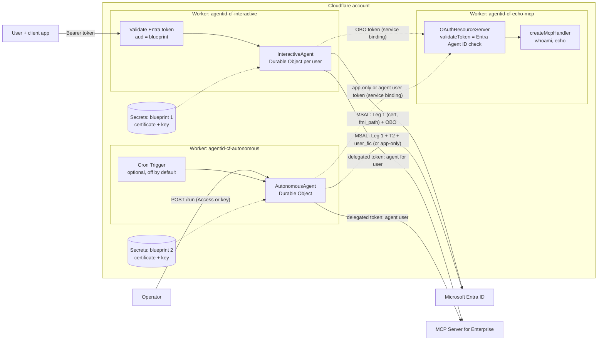

# Microsoft Entra Agent ID on Cloudflare Workers

This sample gives agents that run on Cloudflare (Workers and the Agents SDK on Durable Objects) a
**Microsoft Entra Agent ID**. **MSAL Node** runs inside the Worker, with no sidecar container, and
each agent identity blueprint signs in with a **certificate**.

| Part | Worker | What it shows |
|---|---|---|
| **Interactive agent** | `agentid-cf-interactive` | A signed-in user calls the agent. The agent calls MCP servers **on behalf of the user**, as its agent identity: Microsoft MCP Server for Enterprise and, optionally, the echo MCP server. Workers AI drives the chat. |
| **Autonomous agent** | `agentid-cf-autonomous` | Runs when an operator starts it (through Cloudflare Access or with a key; a schedule is optional) and calls an MCP server **with its own identity**: its agent user (`user_fic`) or app-only. |
| **Echo MCP server** (optional) | `agentid-cf-echo-mcp`, or `agentid-cf-echo-mcp-lite` without packages | An Entra-protected MCP server built with Cloudflare's MCP tooling (`OAuthResourceServer` and `createMcpHandler`). It accepts agent tokens only and tells each caller which Agent ID flow, agent identity, blueprint and user it sees. |
| **Edge key sync** (optional) | `agentid-cf-edge-jwks-sync` | Keeps Cloudflare API Shield's copy of the Entra signing keys current for the optional edge authorizer. |

> **Sample code.** Not production-hardened. It uses two preview features: Microsoft MCP Server for
> Enterprise and, for the autonomous agent-user mode, agent users (Frontier preview program).

## Status

Confirmed on a live tenant and Cloudflare account (November 2026):

* **Interactive agent with Microsoft MCP Server for Enterprise.** MSAL Node 7.x runs on workerd: the
  blueprint signs in with its certificate (Leg 1), the agent identity gets an on-behalf-of token, and
  the chat answers directory questions with Workers AI.
* **Interactive agent with the echo MCP server**, over a service binding. The second on-behalf-of
  token carries the Agent ID claims (`xms_par_app_azp` = the blueprint, `xms_act_fct` with 11,
  `idtyp` = `user`) because the echo app registration lists them as optional claims. The
  Cloudflare-native echo server, with the real packages, reports `"flow": "agent-obo"`, the agent
  identity, its blueprint and the user, both for a direct tool call and in the chat.

Not confirmed live yet:

* The autonomous agent: agent-user mode against MCP Server for Enterprise (agent users are in
  preview, and MCP Server for Enterprise does not document agent-user tokens either way), and
  app-only mode against the echo MCP server.
* The edge authorizer (API Shield JWT validation and WAF rules) on an Enterprise zone. Start with
  `"action": "log"`.
* Cloudflare Access (`ctx.access`) in front of the autonomous Worker.

## How it works



1. **Credential.** Each agent Worker holds its own blueprint's certificate and private key as Worker
   secrets (or in Secrets Store). The key is imported into WebCrypto as non-extractable.
2. **Leg 1.** MSAL's blueprint client sends a certificate-signed client assertion (PS256,
   `x5t#S256`, `x5c`) with `fmi_path = <agent identity>`; Entra returns T1.
3. **Leg 2.** MSAL's agent identity client uses T1 as its client assertion: on-behalf-of the user's
   token (interactive), client credentials (app-only), or T2 and `user_fic` (agent user).
4. **MCP.** The agent calls each MCP server over Streamable HTTP with a token of its own for that
   server. Tokens never reach the model, the logs or the HTTP responses.
5. **Resource side.** The echo MCP server validates the Entra token, works out the flow from the
   Agent ID claims (`azp`, `xms_par_app_azp`, `xms_act_fct`, `xms_sub_fct`), applies a caller policy
   (agents only, allowed blueprints, agent identities and flows) and hands the caller to its tools.

The token requests on the wire and the claims of each flow: [docs/token-flows.md](docs/token-flows.md).

## Quick start

**Run every command from the project root:** the folder that contains `package.json`, `src/`,
`workers/` and `scripts/`. If Windows "Extract All" added an extra folder level, go one level down,
into the folder that has `package.json`:

```powershell
cd C:\src\agentid-cloudflare      # your copy; "dir package.json" must find the file
```

There is one `package.json` and one `node_modules` for all the Workers. A folder under `workers/`
holds only that Worker's `wrangler.jsonc` (and its local `.dev.vars`); the npm scripts select the
Worker with `-c workers/<name>/wrangler.jsonc`, so you never `cd` into it.

You need Node.js 22.6 or later, a Cloudflare account (the Free plan is enough to try it) and a
Microsoft Entra tenant where you can create agent identities. Details and costs:
[docs/cloudflare-deploy-guide.md](docs/cloudflare-deploy-guide.md).

1. **Install:** `npm install`, then `npm test`. Behind a package mirror, run `npm run check:feed`
   first: it lists every package the mirror cannot serve, in one go
   ([docs/restricted-package-feeds.md](docs/restricted-package-feeds.md)).
2. **Certificates:** `npm run cert:interactive` and `npm run cert:autonomous`
   ([docs/certificate-auth.md](docs/certificate-auth.md)).
3. **Entra:** copy `scripts/entra/entra.config.example.json` to `scripts/entra/entra.config.json`,
   edit it (set `"enabled": true` in the `echo` section for the echo MCP server) and run
   `npm run entra:setup`. It creates the blueprints, agent identities, grants and the CLI's client
   app, and prints the values for each Worker ([docs/entra-setup-guide.md](docs/entra-setup-guide.md)).
4. **Configure:** put the printed values into the `vars` of `workers/interactive/wrangler.jsonc` and
   `workers/autonomous/wrangler.jsonc`.
5. **Deploy:** `npm run deploy:interactive` and `npm run deploy:autonomous`, then store each Worker's
   certificate and key with `npx wrangler secret put ... -c workers/<name>/wrangler.jsonc`
   ([bash and PowerShell commands](docs/cloudflare-deploy-guide.md#4-deploy-and-add-the-secrets)).
6. **Check:** `curl https://agentid-cf-interactive.<subdomain>.workers.dev/healthz` (in Windows
   PowerShell 5.1 type `curl.exe`; `curl` is an alias for `Invoke-WebRequest` there).
7. **Interactive agent:** sign in once, then talk to it ([The command-line client](#the-command-line-client)):

   ```bash
   npm run cli -- login --tenant <tenant id> --client <cli app id> --blueprint <interactive blueprint app id> --agent https://agentid-cf-interactive.<subdomain>.workers.dev
   npm run cli -- whoami
   npm run cli -- chat "How many users are in my tenant?"
   ```
8. **Autonomous agent:** it has no schedule; an operator starts each run
   ([The autonomous agent](#the-autonomous-agent)).
9. **Echo MCP server (optional):** deploy it and add it to the interactive agent
   ([The echo MCP server](#the-echo-mcp-server)).

## The echo MCP server

The interactive agent can use two MCP servers at the same time. It asks Entra for a separate
on-behalf-of token for each one: both tokens carry the same agent identity (`azp`) and the same user
(`oid`), each with its own audience (`aud`) and scopes (`scp`).

| Server id | Settings in `workers/interactive/wrangler.jsonc` | Token audience |
|---|---|---|
| `enterprise` | `MCP_SERVER_URL`, `MCP_SCOPES` | Microsoft MCP Server for Enterprise |
| `echo` (optional) | `ECHO_MCP_URL`, `ECHO_MCP_SCOPES` (empty = off), the `ECHO_MCP_SERVICE` binding | The echo app (`api://<echo app id>`) |

1. **Entra.** With the `echo` section enabled, `npm run entra:setup` creates the echo app
   registration (scope `Echo.Read`, app role `Echo.Read.All`), adds the Agent ID optional claims to
   its access tokens, grants the interactive agent identity `Echo.Read` and prints the values for the
   next steps. The optional claims matter: `xms_par_app_azp`, `xms_act_fct` and `xms_sub_fct` are
   claims of the **resource**, so Entra puts them into an agent's token only when the app
   registration of the API asks for them. Without them the echo server cannot tell an agent from any
   other app and answers `403 access_denied`.
2. **Echo server.** Put `TENANT_ID`, `ECHO_APP_ID` and `ALLOWED_BLUEPRINT_IDS` into
   `workers/echo-mcp/wrangler.jsonc` and run `npm run deploy:echo`. It holds no secrets.
3. **Interactive agent.** In `workers/interactive/wrangler.jsonc`, uncomment the service binding, add
   the echo server to `vars` and run `npm run deploy:interactive` (the certificate secrets stay):

   ```jsonc
   "services": [{ "binding": "ECHO_MCP_SERVICE", "service": "agentid-cf-echo-mcp" }],
   "vars": {
     // ... the existing values ...
     "ECHO_MCP_URL": "https://agentid-cf-echo-mcp.<subdomain>.workers.dev/mcp",
     "ECHO_MCP_SCOPES": "api://<echo app id>/Echo.Read"
   }
   ```
4. **Call it:**

   ```bash
   npm run cli -- tools                                     # the tools of both servers
   npm run cli -- call --server echo --tool whoami          # one tool call, no model
   npm run cli -- call --server echo --tool echo --arg message=hello
   npm run cli -- chat --new "Ask the echo server who is calling it"
   npm run cli -- whoami                                    # one on-behalf-of token per server (claims only)
   ```

   The echo server's `whoami` reports `"flow": "agent-obo"`, `clientAppId` = the interactive agent
   identity, `parentBlueprintAppId` = the interactive blueprint and `subjectObjectId` = you.

Why the service binding: a Worker's plain `fetch()` to another Worker on the same zone, such as your
workers.dev subdomain, fails with Cloudflare error 1042 unless the caller has the
`global_fetch_strictly_public` compatibility flag. The binding is Cloudflare's direct Worker-to-Worker
path; the Entra token still goes with every request and the echo server still validates it.
`ECHO_MCP_URL` stays the public URL, because it supplies the path and the host. A call through a
binding has no `Host` header of its own, and `createMcpHandler` checks `Host` on workers.dev endpoints
against DNS rebinding, so the agent sends the host of `ECHO_MCP_URL` and the echo server gives a call
without `Host` the host of its URL. For the dependency-free edition use `agentid-cf-echo-mcp-lite` in
both places.

If the echo server cannot be reached or refuses the token, the agent keeps working with MCP Server for
Enterprise and names the echo error in `tools`, `whoami` and `chat`. Causes and fixes:
[docs/echo-mcp-server.md](docs/echo-mcp-server.md#troubleshooting-the-interactive-agent-to-echo-call).

The autonomous agent can call the echo server in app-only mode, with the `MCP_SERVICE` binding:
[docs/echo-mcp-server.md](docs/echo-mcp-server.md#deploy-and-connect-the-agents).

## The command-line client

`npm run cli -- <command>` calls the interactive agent as a signed-in user. It needs no packages.

| Command | What it does |
|---|---|
| `login --tenant <id> --client <cli app id> --blueprint <app id> [--agent <url>] [--device-code]` | Signs you in for `api://<blueprint>/access_agent` (authorization code with PKCE on `localhost`, or device code) and remembers the agent URL |
| `whoami` | The non-secret claims of the chain: your token, T1 and one on-behalf-of token per MCP server |
| `tools [--json]` | The tools of each MCP server; `--json` adds their input schemas |
| `call --tool <name> [--server <id>] [--arg key=value ...] [--args '<json>']` | One tool call, without the model. `--arg` sends a string and needs no JSON quoting (handy in PowerShell); `--args` takes JSON for other types |
| `chat [--new] [--debug] [--model <id>] "<question>"` | A question for the agent (see [How the chat works](#how-the-chat-works)) |
| `reset` | Clears your conversation |
| `claims` | The claims of your cached sign-in token |
| `logout` | Deletes the cached sign-in |

The sign-in token (one hour, audience = your blueprint) is cached in `.agent-cli/session.json` with
owner-only permissions; `--no-cache` turns that off. `ENTRA_TENANT_ID`, `CLI_CLIENT_ID`,
`BLUEPRINT_CLIENT_ID` and `AGENT_URL` can replace the options, and `ENTRA_ACCESS_TOKEN` skips the
sign-in with a token you obtained elsewhere.

## How the chat works

* **Tools.** For each question the agent connects to every configured MCP server with that server's
  own token and offers the model all their tools. Each description starts with its server, for
  example `[echo MCP server]`. The model sees the echo server's tools as `echo_server_whoami` and
  `echo_server_echo`, so a question about "the echo server" does not land on the tool named `echo`;
  `tools`, `call` and the tool call list keep the server's own names (`echo/whoami`).
* **Model.** Workers AI, `AI_MODEL` (default `@cf/meta/llama-3.3-70b-instruct-fp8-fast`), temperature
  0.2, up to 1,024 output tokens per call and at most six model calls per question.
  `chat --model <id>` uses another model for one request if `AI_MODEL_CHOICES` allows it (default:
  Llama 3.3 70B and `@cf/meta/llama-4-scout-17b-16e-instruct`); set `AI_MODEL` to switch for good.
* **Guard rails.** Repeated identical tool calls run once, and every tool result restates the latest
  question. When the first reply calls no tool, the model is asked once more. A tool call that the
  model writes as text instead of a tool call (`f()`, `[f]`, `[f {}]`, JSON, `<function=f>`) is run
  when it is the whole reply and names an offered tool; a final reply that is only another call is
  replaced by the last tool result. A server that cannot be reached is named in the system prompt
  with its reason, so the model reports it instead of guessing.
* **Memory.** Your last four questions and answers go along until `CHAT_MEMORY_MINUTES` (default 30)
  pass without a message. `chat --new` starts a new conversation and `reset` clears it. A question
  without an answer is not remembered.
* **Debugging.** `chat --debug` prints one line per model call: the tools offered, prompt tokens,
  what the model did and what it said.

The model sees tool names, schemas and results, never a token.

## The autonomous agent

The autonomous agent acts as itself: in `AUTH_MODE=agent-user` (default) as its own agent user, for
resources that accept delegated tokens only, such as MCP Server for Enterprise; in `app-only` mode as
the agent identity, with an app role on the resource, such as the echo MCP server. Each run asks one
question with Workers AI (`JOB_PROMPT`) or makes one tool call (`JOB_TOOL`, `JOB_TOOL_ARGUMENTS`).

It has no schedule: `"crons": []`. An operator starts each run, and a second start while a run is in
progress gets 409.

* `ADMIN_AUTH=admin-key` (default): the `x-admin-key` header must match the `ADMIN_KEY` secret;
  `/status` and `/run` are off until that secret is set.
* `ADMIN_AUTH=access`: Cloudflare Access protects the Worker and the Worker accepts only requests
  that Access authenticated for its application (`ctx.access`, `ACCESS_AUD`). The run record shows
  who started each run.

```bash
# bash
AUTONOMOUS_ADMIN_KEY=... npm run autonomous:run -- --url https://agentid-cf-autonomous.<subdomain>.workers.dev
npm run autonomous:status -- --url https://agentid-cf-autonomous.<subdomain>.workers.dev --last 3
```

```powershell
# PowerShell
$env:AUTONOMOUS_ADMIN_KEY = "..."
npm run autonomous:run -- --url https://agentid-cf-autonomous.<subdomain>.workers.dev
```

With Access, sign in with `cloudflared access login <url>` and set `CF_ACCESS_TOKEN`, or use an
Access service token (`CF_ACCESS_CLIENT_ID`, `CF_ACCESS_CLIENT_SECRET`). For a schedule, add cron
expressions to `triggers.crons`. Details: [docs/cloudflare-deploy-guide.md](docs/cloudflare-deploy-guide.md).

## Endpoints

**Interactive agent** (`Authorization: Bearer <token for api://<blueprint>/access_agent>` on `/api/*`)

| | |
|---|---|
| `GET /healthz` | Configuration and certificate check (thumbprint, expiry) and the configured MCP servers. No token. |
| `GET /api/whoami` | The non-secret claims of the chain: your token, T1 and one on-behalf-of token per MCP server |
| `GET /api/tools` | The tools available to the agent on your behalf, per MCP server |
| `POST /api/tools/call` | `{"name": "...", "arguments": {...}, "server": "echo"}`: one tool call without the model (`server` is optional) |
| `POST /api/chat` | `{"prompt": "...", "newConversation": false, "debug": false, "model": "..."}`: Workers AI chooses and calls the tools. `newConversation` leaves out earlier turns, `debug` adds `trace` (one entry per model call), `model` picks a model from `AI_MODEL_CHOICES` |
| `POST /api/reset` | Clears your conversation |

**Autonomous agent:** `GET /healthz`; for operators `GET /status` (the last runs) and `POST /run`.

**Echo MCP server:** `POST /mcp` (tools `whoami` and `echo`),
`GET /.well-known/oauth-protected-resource/mcp` (names Entra as the authorization server) and `GET /`.
It accepts only agent tokens by default and answers 401, 403 `insufficient_scope`, 403
`access_denied` or 429.

## Where to run commands and where files go

| What | Where | Why |
|---|---|---|
| `npm install`, `npm test`, every `npm run ...` | Project root | npm runs scripts in the root even when you start them from a subfolder |
| `npx wrangler ...` (secrets, `tail`, `delete`, `types`) | Project root | `-c workers/<name>/wrangler.jsonc` and paths such as `certs/...` are relative to the current folder |
| Mirror settings | `.npmrc` in the root, next to `package.json` | Start from `.npmrc.example` |
| Worker settings (`vars`, bindings, crons) | `workers/<name>/wrangler.jsonc` | One file per Worker |
| Local secrets for `npm run dev:*` | `workers/<name>/.dev.vars` | Wrangler reads `.dev.vars` from the folder of the `wrangler.jsonc` it was given |
| Certificates | `certs/<name>/` | Written by `npm run cert:*` |
| Entra setup | `scripts/entra/entra.config.json` | Copy of the `.example` next to it; results go to `scripts/entra/out/` |
| Edge authorizer (optional) | `scripts/cloudflare/edge.config.json` | Copy of the `.example` next to it |
| CLI sign-in cache | `.agent-cli/session.json` | `npm run cli -- logout` deletes it |

Certificates, `.dev.vars`, the Entra and edge configurations and the CLI cache are in `.gitignore`.

## Repository layout

```text
./                package.json, tsconfig.json, .npmrc.example: the project root, run all commands here
src/
  shared/
    entra/        certificate and assertion (WebCrypto), MSAL token service, inbound validation, Agent ID claims
    mcp/          dependency-free MCP Streamable HTTP client; several servers per agent, one token each
    agent/        Workers AI tool loop
    cloudflare/   API Shield token configuration and WAF rule (edge authorizer)
    config.ts     environment validation
    host-header.ts  Host header for service binding calls
  interactive/    Worker and InteractiveAgent: on-behalf-of calls to two MCP servers, chat, conversation memory
  autonomous/     Worker and AutonomousAgent: agent user or app-only, runs started by operators
  echo-mcp/       Entra-protected MCP server, Cloudflare-native (OAuthResourceServer + createMcpHandler)
  echo-mcp-lite/  the same MCP server without packages
  edge-jwks-sync/ optional cron Worker: Entra signing keys to API Shield
workers/<name>/   wrangler.jsonc (and .dev.vars.example) per Worker
scripts/
  cert/           certificate generator
  entra/          Entra setup through Microsoft Graph
  cloudflare/     edge authorizer setup (API Shield JWT validation, WAF custom rules)
  client/         the CLI for the interactive agent; start and inspect autonomous runs
  lib/            sign-in, CLI arguments, the Agent ID optional claims for resource apps
test/             node:test suites; test/support has stand-ins for the MCP packages
docs/             guides (see Documentation)
```

Everything under `scripts/` uses Node.js built-ins only and runs before `npm install`.

## Security notes

* **One blueprint per Worker.** Whoever holds a blueprint credential can obtain tokens for every agent
  identity of that blueprint. Durable Object instances (per user, per job) share their Worker's
  identity; they separate state, not credentials.
* **Who can read the key.** Anyone allowed to deploy code to a Worker can read its secrets. Restrict
  Cloudflare roles and API tokens accordingly, and rotate certificates
  ([rotation](docs/certificate-auth.md#rotation-without-downtime)).
* **Inbound checks** run in the Worker before anything else: signature (tenant keys), issuer, tenant,
  audience = blueprint, v2.0 token, delegated scope and an optional client allow-list.
* **On-behalf-of keeps the user's permissions in force**; the agent identity only gets the scopes an
  administrator granted it.
* **No tokens in logs, responses or prompts.** Diagnostics show claims only. The CLI caches the
  signed-in user's token locally (`.agent-cli/`, owner-only, `--no-cache` to opt out).
* **Entra is the only token issuer.** The Cloudflare layers here validate Entra tokens (API Shield,
  `OAuthResourceServer` with the Entra Agent ID check) or authenticate operators (Access). None of them
  mints a token that replaces the Entra one, so on-behalf-of works and the MCP server still sees the
  agent.
* **Every Worker validates for itself.** Edge rules do not see service binding or same-zone calls.
  The echo server fills in a missing `Host` header only for such internal calls; requests from the
  internet always carry one, and a wrong `Host` is refused.

## Testing

`npm test` runs 122 tests with Node.js alone, without Cloudflare or Entra:

* certificates and client assertions (PKCS#8, PKCS#1, PS256 and RS256, verified with Node's crypto);
* Entra token validation, Agent ID flow classification and the caller policy;
* both echo MCP server editions over HTTP with tokens shaped like each flow; the Cloudflare-native
  edition runs against stand-ins of `OAuthResourceServer`, `createMcpHandler` (including its `Host`
  check) and `McpServer` that follow their documented behaviour;
* the interactive agent's two MCP servers: one token per server, tool routing, the names the model
  sees, service binding calls and one server failing without taking the other down;
* the tool loop against a simulated model, including replays of live Llama 3.3 and Llama 4 Scout
  replies, and the conversation memory;
* configuration validation, the CLI's argument handling, the Entra setup's optional claims, operator
  authorization and the operator command, the edge authorizer against a simulated Cloudflare API, and
  the npm mirror check.

`npm run typecheck` checks the Workers' code against the installed packages' types.

## Documentation

| | |
|---|---|
| [docs/token-flows.md](docs/token-flows.md) | Leg 1, on-behalf-of, agent user and app-only on the wire; the claims of each flow; common errors |
| [docs/certificate-auth.md](docs/certificate-auth.md) | Why a certificate, the assertion format, creating, storing and rotating certificates |
| [docs/msal-options.md](docs/msal-options.md) | Which MSAL runs on Cloudflare, and how MSAL Node is used here |
| [docs/entra-setup-guide.md](docs/entra-setup-guide.md) | Blueprints, agent identities, agent user, grants and the echo app's optional claims: the script or the Graph requests |
| [docs/cloudflare-deploy-guide.md](docs/cloudflare-deploy-guide.md) | Prerequisites and costs, configuration reference, secrets, deployment, tests, local development, troubleshooting |
| [docs/cloudflare-built-ins.md](docs/cloudflare-built-ins.md) | Which Cloudflare built-ins fit Entra Agent ID: validation in the Worker and at the edge, Access, MCP tooling, and what does not fit |
| [docs/echo-mcp-server.md](docs/echo-mcp-server.md) | The Entra-protected MCP server: both editions, flows, caller policy, responses, deployment, troubleshooting |
| [docs/restricted-package-feeds.md](docs/restricted-package-feeds.md) | Package mirrors: what must be mirrored, the mirror check, fallbacks |
| [CHANGELOG.md](CHANGELOG.md) | What changed, by date |

## Related

* Microsoft Entra Agent ID: https://learn.microsoft.com/entra/agent-id/what-is-microsoft-entra-agent-id
* Token claims reference for agent IDs: https://learn.microsoft.com/entra/agent-id/agent-token-claims
* MSAL guide, FIC and FMI in agentic scenarios: https://github.com/AzureAD/microsoft-authentication-library-for-dotnet/wiki/How-to-Use-FIC-and-FMI-in-Agentic-Scenarios
* Microsoft MCP Server for Enterprise: https://learn.microsoft.com/graph/mcp-server/overview
* Cloudflare Agents: https://developers.cloudflare.com/agents/
* `createMcpHandler`: https://developers.cloudflare.com/agents/model-context-protocol/apis/handler-api/
* `OAuthResourceServer`: https://github.com/cloudflare/workers-oauth-provider/blob/main/docs/resource-servers.md
