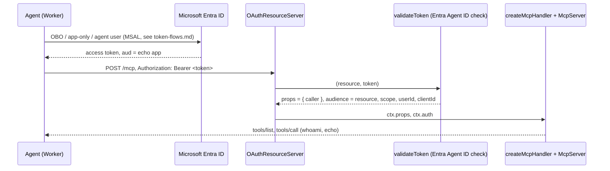

# The echo MCP server: an Entra-protected MCP server on Cloudflare

An MCP server that runs on Cloudflare, is guarded by Cloudflare's MCP tooling, accepts only
Microsoft Entra tokens and tells each caller how it sees them: which **Agent ID flow**, which
**agent identity**, which **blueprint**, which **user**. Use it to see the claims of every flow and
to test the autonomous agent's app-only mode (Microsoft MCP Server for Enterprise accepts
delegated tokens only).

Two editions with the same tools, checks and responses:

| | Cloudflare-native (`workers/echo-mcp`) | Dependency-free (`workers/echo-mcp-lite`) |
|---|---|---|
| MCP server | `McpServer` from `@modelcontextprotocol/server` (SDK v2), served by `createMcpHandler` from `agents/mcp/server` | ~100-line JSON-RPC handler |
| Token guard | `OAuthResourceServer` from `@cloudflare/workers-oauth-provider` with our Entra `validateToken` | Same checks, our own code |
| Tools get the caller from | `getMcpAuthContext()` and `context.http.authInfo` | Function argument |
| Packages | `agents`, `@modelcontextprotocol/server`, `@cloudflare/workers-oauth-provider`, `zod` | None |
| Use when | Default | Your package mirror lacks the MCP packages |

## How a request is handled (Cloudflare-native)



1. **No token:** 401 with `WWW-Authenticate: Bearer ... resource_metadata=".../.well-known/oauth-protected-resource/mcp"`.
2. **Metadata** (RFC 9728) names `https://login.microsoftonline.com/<tenant>/v2.0` as the authorization
   server and `api://<echo app id>/Echo.Read` as the scope.
3. **`validateToken`** (`entraAgentIdValidator` in `src/echo-mcp/index.ts`):
   * signature against the tenant's signing keys (OIDC discovery, cached per isolate, refreshed on an unknown `kid`);
   * issuer and tenant, v2.0 token, audience `<echo app id>` or `api://<echo app id>`, lifetime;
   * delegated tokens need the scope `Echo.Read`, application tokens the app role `Echo.Read.All`;
   * classify the caller (`src/shared/entra/agent-caller.ts`) and apply the caller policy.
4. **Handler:** optional per-agent rate limit, then the MCP handler. One structured audit line per
   tool call goes to Workers Logs (flow, agent identity, blueprint, subject; never the token).

## Telling the flows apart

| Flow | `idtyp` | `azp` | `oid` | `xms_par_app_azp` | facets |
|---|---|---|---|---|---|
| `agent-obo`: agent acting for a user | user | agent identity | the user | blueprint | `xms_act_fct` 11 |
| `agent-app-only`: agent as itself | app | agent identity | agent identity | blueprint | `xms_act_fct` 11, `xms_sub_fct` 11 |
| `agent-user`: agent as its agent user | user | agent identity | agent user | blueprint | `xms_act_fct` 11, `xms_sub_fct` 13 |
| `delegated` / `app-only`: not an agent | user / app | client app | user / app | absent | - |

**`xms_par_app_azp`, `xms_act_fct`, `xms_sub_fct` and `xms_tnt_fct` are optional claims of the
echo app registration.** Entra emits them only for an API whose app registration lists them under
`optionalClaims.accessToken`; the same goes for `idtyp` in delegated tokens (additional property
`include_user_token`). `npm run entra:setup` adds them to the echo app. Without them every agent
token looks like a regular app's token and the server answers `403 access_denied` ("The token has
no Agent ID claims"). The manifest fragment is in [entra-setup-guide.md](entra-setup-guide.md#echo-mcp-server-optional).

`whoami` returns this classification plus `verifiedByCloudflare` (what `OAuthResourceServer` put in
`ctx.auth`: client ID, scopes, expiry).

## Caller policy

`wrangler.jsonc` vars (comma-separated lists; empty means no restriction):

| Variable | Effect |
|---|---|
| `REQUIRE_AGENT_CALLER` | `true` (default): only tokens issued to agent identities (any Agent ID claim present; they are optional claims, see above) |
| `ALLOWED_CALLER_FLOWS` | Any of `agent-obo`, `agent-app-only`, `agent-user`, `delegated`, `app-only` |
| `ALLOWED_BLUEPRINT_IDS` | Only agents of these blueprints. `npm run entra:setup` prints this sample's two. Microsoft recommends logging the blueprint (`xms_par_app_azp`) and not relying on it alone, since one blueprint can have many agents: pair it with `ALLOWED_AGENT_IDS` for a tight list |
| `ALLOWED_AGENT_IDS` | Only these agent identities (`azp`) |
| `ECHO_REQUIRED_SCOPE` / `ECHO_REQUIRED_ROLE` | Default `Echo.Read` / `Echo.Read.All` |
| `ECHO_RESOURCE_URL` | Public URL of `/mcp`. Set it on Custom Domains; default is the request origin |
| `ECHO_ALLOWED_HOSTNAMES` | Custom Domain host names for the MCP handler's Host check |

## Responses

| Status | When | Challenge |
|---|---|---|
| 401 `invalid_token` | Missing, malformed, expired, wrong issuer/tenant/audience, v1 token | Yes, with `resource_metadata` and `scope` |
| 403 `insufficient_scope` | Delegated token without `Echo.Read`, app token without `Echo.Read.All` | Yes |
| 403 `access_denied` | Valid token, but the caller policy refuses it (not an agent, other blueprint, other flow) | No (it is not an authentication problem) |
| 429 `rate_limited` | Rate limit binding refused this agent identity | `Retry-After: 60` |
| 503 | The tenant's signing keys could not be fetched | - |

## Deploy and connect the agents

1. **Entra:** enable the `echo` section in `scripts/entra/entra.config.json` and run `npm run entra:setup`.
   It creates the echo app (`Echo.Read` scope, `Echo.Read.All` app role, and the Agent ID optional
   claims for its access tokens), grants the interactive agent identity the scope, assigns the app
   role to the autonomous agent identity and grants its agent user the scope.
2. **Configure** `workers/echo-mcp/wrangler.jsonc` with the printed `TENANT_ID`, `ECHO_APP_ID` and
   `ALLOWED_BLUEPRINT_IDS`. No secrets: the server holds no credential.
3. **Deploy:** `npm run deploy:echo` (or `npm run deploy:echo-lite`).
4. **Point an agent at it.** Both agents reach it over a **service binding**: a Worker's plain
   `fetch()` to another Worker on the same zone, such as your workers.dev subdomain, fails with
   Cloudflare error 1042 unless the caller has the `global_fetch_strictly_public` compatibility flag.
   The binding is the direct Worker-to-Worker path; the Entra token is still sent and validated here.
   Keep the URL variables on the public `/mcp` URL (path and host). A binding call has no `Host`
   header of its own, and `createMcpHandler` checks `Host` on workers.dev endpoints, so the agents
   send the host of that URL and this server gives a call without `Host` the host of its URL.

   **Interactive agent (OBO), next to MCP Server for Enterprise.** The agent keeps
   `MCP_SERVER_URL` / `MCP_SCOPES` and gets the echo server as a second MCP server with its own
   on-behalf-of token. The model sees its tools as `echo_server_whoami` and `echo_server_echo`, so a
   question about "the echo server" does not land on the tool named `echo`; `tools` and `call` keep
   the server's names (`workers/interactive/wrangler.jsonc`):
   ```jsonc
   "services": [{ "binding": "ECHO_MCP_SERVICE", "service": "agentid-cf-echo-mcp" }],
   "vars": {
     "ECHO_MCP_URL": "https://agentid-cf-echo-mcp.<subdomain>.workers.dev/mcp",
     "ECHO_MCP_SCOPES": "api://<echo app id>/Echo.Read"
   }
   ```
   **Autonomous agent, app-only** (`workers/autonomous/wrangler.jsonc`; it calls one MCP server):
   ```jsonc
   "services": [{ "binding": "MCP_SERVICE", "service": "agentid-cf-echo-mcp" }],
   "vars": {
     "AUTH_MODE": "app-only",
     "MCP_SERVER_URL": "https://agentid-cf-echo-mcp.<subdomain>.workers.dev/mcp",
     "MCP_SCOPES": "api://<echo app id>/.default",
     "JOB_TOOL": "whoami"
   }
   ```
   For the lite edition, use `agentid-cf-echo-mcp-lite` as the service and in the URL.
5. **Check:**
   ```bash
   curl https://agentid-cf-echo-mcp.<subdomain>.workers.dev/.well-known/oauth-protected-resource/mcp
   npm run cli -- tools                                  # the interactive agent lists "enterprise" and "echo"
   npm run cli -- call --tool whoami                     # interactive agent -> echo server, OBO
   npm run cli -- call --tool echo --arg message=hello
   npm run cli -- chat --new "Ask the echo server who is calling it"
   curl -X POST -H "x-admin-key: ..." https://agentid-cf-autonomous.<subdomain>.workers.dev/run
   ```
   (Windows PowerShell 5.1: type `curl.exe`.) The interactive agent's call should come back with
   `"flow": "agent-obo"`, `clientAppId` = the interactive agent identity, `parentBlueprintAppId` =
   the interactive blueprint and `subjectObjectId` = your object ID. `npm run cli -- whoami` shows the
   agent's two OBO tokens: same `azp` and `oid`, `aud` = MCP Server for Enterprise and the echo app.

## Troubleshooting the interactive agent to echo call

The agent reports an echo failure without losing MCP Server for Enterprise: `npm run cli -- tools`
prints `echo ... not available: ...`, `whoami` shows the error under `tokens.leg2_on_behalf_of.echo`,
and `chat` ends with `(MCP server 'echo' was not available: ...)`. `npx wrangler tail -c
workers/echo-mcp/wrangler.jsonc` shows what the echo server decided.

| What you see | Cause | Fix |
|---|---|---|
| `configuration_error: ECHO_MCP_SCOPES is not set` (or URL not valid) | Incomplete `vars` | Set both `ECHO_MCP_URL` and `ECHO_MCP_SCOPES`, deploy the agent |
| `token_acquisition_failed`, `AADSTS65001` or another consent error | The interactive agent identity has no grant for `Echo.Read` | Enable `echo` in the Entra config and run `npm run entra:setup` (AllPrincipals grant) |
| `token_acquisition_failed`, `AADSTS500011` | The echo app has no service principal in the tenant, or `ECHO_MCP_SCOPES` names the wrong app ID | Run `npm run entra:setup`; copy the scope it prints |
| `token_acquisition_failed`, `AADSTS70011` | Malformed scope, for example `Echo.read` or `.default` mixed with other scopes | Use exactly `api://<echo app id>/Echo.Read` |
| `mcp_http_error` whose message contains `error code: 1042` | Plain `fetch()` between two Workers on the same zone | Add the `ECHO_MCP_SERVICE` binding (or the `global_fetch_strictly_public` flag on the agent) |
| `mcp_http_error` 404 (no 1042) | `ECHO_MCP_URL` lacks `/mcp`, or names another Worker or subdomain | Use `mcpEndpoint` from `GET /` of the echo server |
| `mcp_http_error` 403 `{"jsonrpc":"2.0","error":{"code":-32000,"message":"Missing Host header"}}` | A service binding call has no `Host` header, and `createMcpHandler` checks `Host` on workers.dev endpoints (DNS rebinding protection). The token was already accepted at this point | Apply update 3, then `npm run deploy:echo` and `npm run deploy:interactive` (either one alone fixes it; deploy both) |
| `mcp_http_error` 403 `Invalid Host: <name>` | The host of `ECHO_MCP_URL` is not the echo server's own host name: another Worker name or subdomain, or a custom domain missing from the echo server's `ECHO_ALLOWED_HOSTNAMES` | Use `mcpEndpoint` from `GET /` of the echo server; on a custom domain add it to `ECHO_ALLOWED_HOSTNAMES` |
| `mcp_http_error` 401 `invalid_token`, audience | The echo server's `ECHO_APP_ID` differs from the app in `ECHO_MCP_SCOPES` | Make them the same app ID; redeploy the echo server |
| `mcp_http_error` 401 `invalid_token`, issuer or v1 token | Echo `TENANT_ID` wrong, or the echo app issues v1 tokens | Fix `TENANT_ID`; `npm run entra:setup` sets `requestedAccessTokenVersion` 2 |
| `mcp_http_error` 403 `insufficient_scope` | The token lacks `Echo.Read` (another scope was requested) | Request `api://<echo app id>/Echo.Read` |
| `mcp_http_error` 403 `access_denied`, "no Agent ID claims" (older builds: "no xms_par_app_azp in the token") | The echo app registration does not list the Agent ID optional claims, so Entra leaves them out | Run `npm run entra:setup -- --only echo` (or add them in the Manifest), then redeploy the agent: it keeps the token it already has until it expires. `whoami` must show `xms_par_app_azp` under `leg2_on_behalf_of.echo` |
| `mcp_http_error` 403 `access_denied`, other message | Caller policy: interactive blueprint not in `ALLOWED_BLUEPRINT_IDS`, `agent-obo` not in `ALLOWED_CALLER_FLOWS`, or agent not in `ALLOWED_AGENT_IDS` | Add the interactive blueprint (and agent identity) to the lists, redeploy the echo server |
| `mcp_http_error` 503 | The echo server cannot load the tenant's signing keys (placeholder `TENANT_ID`) | Set the real tenant ID |
| `unknown_tool` with `whoami` missing from `available` | The echo server is not connected (see the other errors), or `ECHO_MCP_URL` is empty | `npm run cli -- tools` shows why |
| `chat` gives a non-answer and no tool calls, with no "not available" line | The echo server is connected; the model did not call a tool | `npm run cli -- call --server echo --tool whoami` (no model involved); `chat --debug` shows each model step; `chat --model <id>` tries another model. See the deploy guide's troubleshooting |

## Tests

`npm test` runs both editions in Node:

* `test/echo-mcp.test.ts`: the dependency-free edition over HTTP with tokens shaped like each flow,
  policy, rate limit, metadata.
* `test/echo-mcp-native.test.ts`: the Cloudflare-native edition's wiring. `OAuthResourceServer`,
  `createMcpHandler` and `McpServer` are replaced by small stand-ins (`test/support/stubs`) that
  follow their documented contracts, so this checks our validator, error mapping, `ctx.props` to
  tools, and the rate limit, not the real packages. Run `npm run dev:echo` for the real thing.
