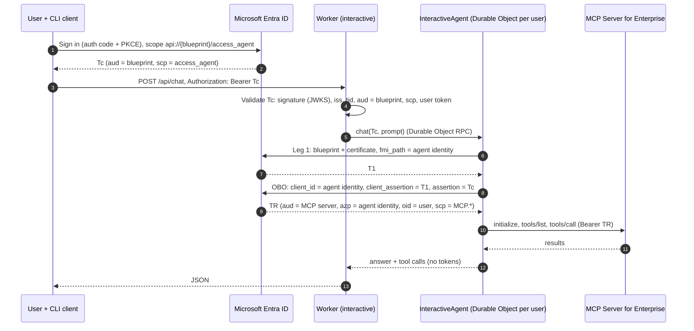
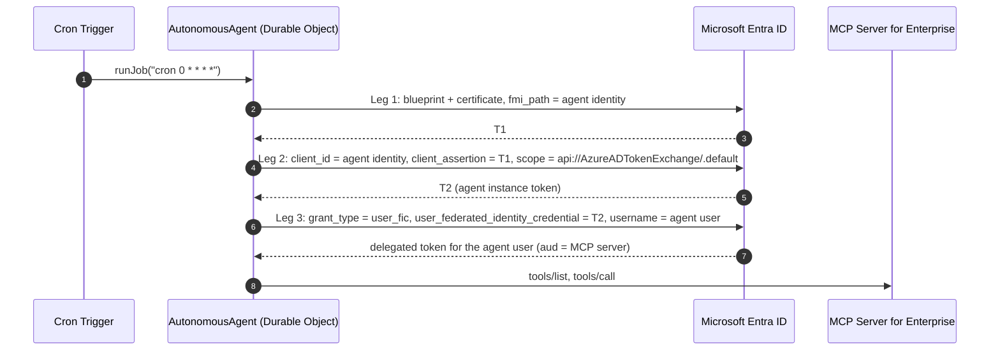

# Token flows: what happens on the wire

This sample uses three Microsoft Entra Agent ID flows. All of them start the same way: the
**agent identity blueprint** proves itself with its **certificate** and asks Entra for a token
that lets it act as its **agent identity** (Leg 1, `fmi_path`). Everything else builds on that.

| Scenario | Worker | Flow | Token the MCP server receives |
|---|---|---|---|
| Interactive | `agentid-cf-interactive` | Leg 1 + **on-behalf-of** (OBO) | Delegated: the agent identity acting for the signed-in user |
| Autonomous, `AUTH_MODE=agent-user` | `agentid-cf-autonomous` | Leg 1 + Leg 2 (T2) + **user_fic** | Delegated: the agent's own **agent user** |
| Autonomous, `AUTH_MODE=app-only` | `agentid-cf-autonomous` | Leg 1 + **client credentials** | Application: the agent identity itself |

> Microsoft MCP Server for Enterprise accepts **delegated tokens only** ("App-only permissions
> or app-only workflows aren't supported", *Get started with the Microsoft MCP Server for
> Enterprise*). An autonomous agent therefore reaches it through its agent user. Use
> `app-only` for MCP servers that accept application permissions, such as the echo MCP server
> in this repository.

## Leg 1: blueprint to T1 (all flows)

MSAL call (blueprint confidential client, `src/shared/entra/agent-token-service.ts`):

```ts
blueprintApp.acquireTokenByClientCredential({
  scopes: ["api://AzureADTokenExchange/.default"],
  fmiPath: AGENT_IDENTITY_ID,
});
```

Wire request:

```http
POST https://login.microsoftonline.com/{tenant}/oauth2/v2.0/token
Content-Type: application/x-www-form-urlencoded

client_id={blueprint app id}
&scope=api://AzureADTokenExchange/.default
&fmi_path={agent identity id}
&grant_type=client_credentials
&client_assertion_type=urn:ietf:params:oauth:client-assertion-type:jwt-bearer
&client_assertion={certificate-signed JWT, see below}
```

The client assertion is built by `src/shared/entra/client-assertion.ts` with WebCrypto and
handed to MSAL through the `clientAssertion` callback:

```json
// header
{ "alg": "PS256", "typ": "JWT", "x5t#S256": "<base64url SHA-256 of the certificate>", "x5c": ["<base64 DER certificate>"] }
// payload
{ "aud": "https://login.microsoftonline.com/{tenant}/oauth2/v2.0/token",
  "iss": "{blueprint app id}", "sub": "{blueprint app id}",
  "jti": "<uuid>", "nbf": 1762800000, "iat": 1762800000, "exp": 1762800600 }
```

* `PS256` + `x5t#S256` is the current format (Microsoft Learn, *certificate credentials*:
  `alg` "should be PS256"). `ASSERTION_ALGORITHM=RS256` switches to the legacy `RS256` + `x5t`.
* `x5c` is always sent. The MSAL guide *How to use FIC and FMI in agentic scenarios* states the
  blueprint must use Subject Name + Issuer (send `x5c`) for the FMI request, otherwise Entra
  rejects Leg 1.
* MSAL caches T1 (per `fmi_path`), so most requests skip this leg.

## Interactive: on-behalf-of the user



MSAL call (agent identity confidential client, whose credential is the callback returning T1):

```ts
agentApp.acquireTokenOnBehalfOf({
  oboAssertion: Tc,                       // the raw inbound token, no "Bearer "
  scopes: ["api://e8c77dc2-69b3-43f4-bc51-3213c9d915b4/.default"],
});
```

Wire request:

```http
POST https://login.microsoftonline.com/{tenant}/oauth2/v2.0/token

client_id={agent identity id}
&client_assertion_type=urn:ietf:params:oauth:client-assertion-type:jwt-bearer
&client_assertion={T1}
&grant_type=urn:ietf:params:oauth:grant-type:jwt-bearer
&assertion={Tc}
&requested_token_use=on_behalf_of
&scope=api://e8c77dc2-69b3-43f4-bc51-3213c9d915b4/.default
```

Requirements (Microsoft Learn, *agent on-behalf-of flow*):

* `Tc` must be issued **for the blueprint** (`aud` = blueprint app ID). A token for another
  resource is rejected with `AADSTS50013`. That is why the inbound check in the Worker accepts
  only the blueprint audience.
* The agent identity needs the delegated MCP scopes granted by an administrator (agent
  identities cannot be consented interactively; `AADSTS82014`). The Entra setup guide does this
  with an `oauth2PermissionGrant`, or through inheritable permissions on the blueprint.
* MSAL Node caches the OBO result keyed by the user's assertion.
* **One OBO token per MCP server.** With `ECHO_MCP_URL` set, the interactive agent repeats the
  exchange with `scope=api://{echo app id}/Echo.Read` and sends that token only to the echo server.
  Both tokens have the same `azp` (agent identity) and `oid` (user); `aud` and `scp` differ. The
  blueprint appears as `xms_par_app_azp` only in tokens for a resource whose app registration lists
  the Agent ID optional claims (the echo app does after `npm run entra:setup`). The agent identity
  needs a grant on each resource; a missing grant fails only that server's exchange.

## Autonomous, agent user (`user_fic`)



MSAL calls:

```ts
const t2 = await agentApp.acquireTokenByClientCredential({ scopes: ["api://AzureADTokenExchange/.default"] });
const user = await agentApp.acquireTokenByUserFederatedIdentityCredential({
  scopes: ["api://e8c77dc2-69b3-43f4-bc51-3213c9d915b4/.default"],
  assertion: t2.accessToken,
  username: AGENT_USER_UPN,            // or userObjectId: AGENT_USER_ID
});
// later runs: agentApp.acquireTokenSilent({ scopes, account: user.account })
```

Wire request for Leg 3:

```http
POST https://login.microsoftonline.com/{tenant}/oauth2/v2.0/token

client_id={agent identity id}
&client_assertion_type=urn:ietf:params:oauth:client-assertion-type:jwt-bearer
&client_assertion={T1}
&grant_type=user_fic
&user_federated_identity_credential={T2}
&username={agent user UPN}            (or user_id={agent user object id})
&scope=api://e8c77dc2-69b3-43f4-bc51-3213c9d915b4/.default
```

Notes:

* The agent user is an Entra user object of type `agentUser` whose `identityParentId` is the
  agent identity. Agent users are currently available to tenants in the **Frontier** preview
  program (Microsoft Agent 365 documentation).
* Agent users have restricted default permissions (Microsoft Learn compares them to guest
  users). Directory questions such as "how many users" may need a non-privileged directory role,
  for example Directory Readers.
* The delegated grant is per user: `consentType = Principal`, `principalId` = the agent user.

## Autonomous, app-only

```ts
agentApp.acquireTokenByClientCredential({ scopes: ["api://{echo app id}/.default"] });
```

```http
client_id={agent identity id}
&client_assertion_type=urn:ietf:params:oauth:client-assertion-type:jwt-bearer
&client_assertion={T1}
&grant_type=client_credentials
&scope=api://{resource}/.default
```

The agent identity needs an **app role assignment** on the resource. Not supported by
Microsoft MCP Server for Enterprise; works with the echo MCP server (`Echo.Read.All`).

## Telling the flows apart in the resource

From *Agent token claims* (Microsoft Learn). The echo MCP server's `whoami` tool reports these.

| Flow | `idtyp` | Facet claims | Other |
|---|---|---|---|
| OBO | `user` | `xms_act_fct` = 11 | `oid` = the user, `azp` = agent identity |
| App-only | `app` | `xms_act_fct` = 11, `xms_sub_fct` = 11 | `oid` = agent identity |
| Agent user | `user` | `xms_act_fct` = 11, `xms_sub_fct` = 13 | `oid` = the agent user |

All three carry `xms_par_app_azp` = the parent blueprint. A resource that wants to accept only
agents checks for it (*Validate agent tokens in a downstream API*).

**These are optional claims of the resource, not of the agent.** Entra emits `xms_par_app_azp`,
`xms_act_fct`, `xms_sub_fct` and `xms_tnt_fct` only in access tokens for an API whose app
registration lists them under `optionalClaims.accessToken` (*Token claims reference for agent
IDs*). `idtyp` is the same: by default only app-only tokens carry it; the additional property
`include_user_token` adds `"idtyp": "user"` to delegated tokens. Nothing changes on the blueprint
or the agent identity. A resource without these optional claims receives agent tokens that look
like any other app's token, so an "agents only" check refuses them. `npm run entra:setup` adds the
claims to the echo app; the manifest fragment is in [entra-setup-guide.md](entra-setup-guide.md#echo-mcp-server-optional).

`src/shared/entra/agent-caller.ts` turns these claims into a flow (`agent-obo`, `agent-app-only`,
`agent-user`, or `delegated` / `app-only` for non-agents) and applies a caller policy: agents only,
allowed flows, blueprints (`xms_par_app_azp`) and agent identities (`azp`). Both echo MCP servers
use it; see [echo-mcp-server.md](echo-mcp-server.md).

## Seeing it live

`GET /api/whoami` on the interactive agent returns the non-secret claims of the three tokens
in the chain (your inbound token, T1, the OBO token). Tokens themselves are never returned,
logged or given to the LLM.

## Common errors

| Error | Typical cause | Fix |
|---|---|---|
| `AADSTS700016` | Blueprint app ID or tenant wrong | Check `TENANT_ID`, `BLUEPRINT_CLIENT_ID` |
| `AADSTS700027` | Assertion signature not accepted: certificate not uploaded to the blueprint, or key and certificate do not match | Compare `/healthz` thumbprint with the blueprint's certificate |
| `AADSTS700024` | Assertion outside its validity window | Clock or lifetime; the sample uses 10 minutes |
| `AADSTS50013` | OBO user token is not for the blueprint | Client must request `api://{blueprint}/access_agent` |
| `AADSTS65001` | No consent for the MCP scopes | Grant the delegated scopes to the agent identity |
| `AADSTS82014` | Tried to consent interactively for an agent identity | Use the admin grant from the setup guide |
| `AADSTS500011` | Resource not provisioned in the tenant | Create the MCP server service principal |
| `AADSTS70011` | Invalid scope string | Use `api://e8c77dc2-69b3-43f4-bc51-3213c9d915b4/.default` |
| MCP HTTP 401 with `WWW-Authenticate` | Token audience or scopes not accepted by the MCP server | The response's challenge says why |

See also the Agent ID error reference: https://learn.microsoft.com/entra/agent-id/error-codes
